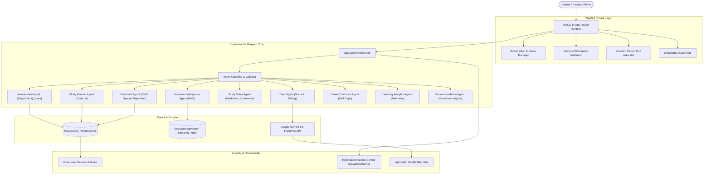

# CITADEL – Education Agent
> **"Learn Smarter. Grow Faster. Achieve More."**

An enterprise-ready, AI-native personalized education SaaS platform developed by **CITADEL**. Powered by Google Gemini 1.5, Next.js 14 App Router, TypeScript, Tailwind CSS, Supabase pgvector, and a 9-specialist multi-agent orchestration architecture.

---

## 🌟 Executive Overview

CITADEL Education Agent is designed for modern academic institutions, competitive examination aspirants, university students, and technical self-learners. Rather than serving generic one-size-fits-all answers, CITADEL dynamically adapts explanations, generates personalized curricula, ingests complex textbooks into grounded RAG citations, and tracks retention using mathematically optimized SM-2 spaced repetition.

### Core Value Pillars
- **Socratic Pedagogical Depth**: Explains concepts step-by-step with progressive hints, real-world analogies, and complexity controls (`Simple`, `Intermediate`, `Advanced/Rigorous`).
- **Grounded Document Intelligence**: Upload PDFs, DOCX, TXT, and Markdown files; ask questions with verifiable section and page citations.
- **Scientifically Calibrated Retention**: SuperMemo SM-2 algorithm calculates personalized review intervals based on card recall difficulty.
- **Autonomous Multi-Agent Orchestration**: A central Supervisor Agent classifies user intent and routes tasks across 9 specialized autonomous agents.
- **Commercial SaaS Ready**: 3-tier subscription system (`Free`, `Student Pro`, `Institution`), quota metering, multi-tenant campus workspaces, and faculty cohort management.

---

## 🏗️ System Architecture



---

## 🤖 The 9 Specialized Agents

| # | Agent Name | Route / Endpoint | Description & Capabilities |
|---|------------|------------------|----------------------------|
| 1 | **Supervisor Agent** | `/api/agent/orchestrate` | Classifies student intents, dynamically selects specialist agents, passes cross-agent context, and synthesizes unified responses. |
| 2 | **Tutor Agent** | `/tutor`, `/api/agent/chat` | Delivers streaming Socratic dialogues, progressive hints, code rendering, and adapts depth across Elementary, Intermediate, and Rigorous levels. |
| 3 | **Study Planner Agent** | `/study-planner`, `/api/agent/plan` | Generates milestones, task checklists, estimated study hours, and exam target timelines. |
| 4 | **Assessment Agent** | `/assessment`, `/api/agent/quiz`, `/api/agent/evaluate` | Generates diagnostic quizzes with MCQ, True/False, and Conceptual problems; scores submissions with gap analysis and recommended revision. |
| 5 | **Document Intelligence Agent** | `/documents`, `/api/documents/upload`, `/api/documents/query` | Parses multipart PDF/DOCX/TXT/MD files, extracts concepts, performs chunking, vector indexing, and answers grounded in page citations. |
| 6 | **Study Notes Agent** | `/notes`, `/api/notes` | Formats comprehensive study guides with definitions, formulas, and cheat sheets with a live Markdown editor and `.md` export. |
| 7 | **Flashcard Agent** | `/flashcards`, `/api/flashcards` | Implements the SuperMemo SM-2 algorithm (`EF'`, `I = I * EF`), scheduling review dates based on student ratings (Hard, Good, Easy). |
| 8 | **Career Guidance Agent** | `/career-guidance`, `/api/career/recommend` | Analyzes student skills against 8 technical industry tracks (AI/ML, Full Stack, Cloud, Cyber, etc.), detecting gaps and prescribing portfolio projects. |
| 9 | **Recommendation & Analytics Agent** | `/insights`, `/analytics`, `/api/analytics` | Synthesizes activity telemetry into prioritized pedagogical recommendations and interactive Recharts mastery graphs. |

---

## 💼 Commercial SaaS & Workspaces

### 1. Subscription Tiers & Feature Matrix

| Feature | Free Tier | Student Pro ($19/mo) | Campus Institution ($799/mo) |
|---|---|---|---|
| **Monthly AI Queries** | 50 queries | 500 queries | 10,000 pooled queries |
| **Document Uploads** | Up to 3 files | Up to 50 files | Unlimited campus library |
| **Document Size Limit** | 5 MB | 25 MB | 100 MB |
| **SM-2 Flashcards** | 30 cards | Unlimited | Unlimited |
| **Career Roadmaps** | 1 track | All 8 industry tracks | Custom institutional curricula |
| **Institutional RBAC** | – | – | Full Admin & Educator controls |
| **Cohort Management** | – | – | Included with assignment tracking |
| **SLA & Support** | Community | Priority email (<4 hr) | Dedicated TAM + 99.9% uptime SLA |

### 2. Multi-Tenant Workspaces
- **Campus Workspace (`/institution`)**: Manage multi-seat licenses, invite faculty and students by email domain, and view aggregated departmental mastery.
- **Educator Hub (`/educator`)**: Create student cohorts, distribute syllabus reading packs, and monitor assignment completion rates.
- **Subscription Management (`/subscription`)**: Real-time quota consumption progress bars, monthly token tracking, and plan upgrade workflows.
- **Help Center & FAQ (`/help`)**: Interactive searchable knowledge base, 1-click feature tours, and ticket submission with tracking IDs (`CTDL-HELP-xxxx`).

---

## 🛠️ Technology Stack

- **Framework**: [Next.js 14](https://nextjs.org/) (App Router, React 18 Server & Client Components)
- **Language**: TypeScript 5+ (Strict mode)
- **Styling**: Tailwind CSS, PostCSS, Lucide Icons
- **Data Visualization**: [Recharts 2.15](https://recharts.org/) (Interactive AreaCharts, ResponsiveContainers)
- **AI Gateway**: Google Gemini 1.5 Flash & 1.5 Pro via `@google/genai`
- **Database**: PostgreSQL with `pgvector` extension via Supabase
- **Security**: Strict HTTP headers (HSTS, CSP, X-Frame-Options: DENY), Row-Level Security (RLS), RBAC role protection

---

## 🚀 Quickstart & Local Setup

### 1. Clone & Install Dependencies
```bash
git clone https://github.com/citadel-ai/education-agent.git
cd education-agent
npm install
```

### 2. Configure Environment Variables
Copy `.env.example` to `.env.local`:
```bash
cp .env.example .env.local
```
Fill in your credentials:
```env
# Google AI Studio API Key (https://aistudio.google.com/)
GEMINI_API_KEY=your_gemini_api_key

# Supabase Credentials (optional for cloud persistence)
NEXT_PUBLIC_SUPABASE_URL=https://your-project.supabase.co
NEXT_PUBLIC_SUPABASE_ANON_KEY=your_anon_key
SUPABASE_SERVICE_ROLE_KEY=your_service_role_key

# Stripe / Razorpay (optional for payment processing)
STRIPE_SECRET_KEY=sk_test_...
STRIPE_WEBHOOK_SECRET=whsec_...
```
*(Note: If `GEMINI_API_KEY` is not provided, CITADEL automatically runs in simulated high-fidelity mode with deterministic pedagogical responses.)*

### 3. Database Migrations
Execute the SQL migration scripts in your Supabase SQL Editor in the following order:
1. `supabase/migrations/20261110_init_citadel.sql` (Core tables, vector extension, profiles, chat, documents, flashcards)
2. `supabase/migrations/20261110_phase4_intelligence.sql` (Career guidance, recommendations, execution logs, user roles)
3. `supabase/migrations/20261110_phase5_saas.sql` (Subscriptions, usage metering, institutions, cohorts, assignments)

### 4. Run Development Server
```bash
npm run dev
```
Open [http://localhost:3000](http://localhost:3000) in your browser.

### 5. Production Build Verification
```bash
npm run build
npm start
```

---

## 🔒 Security, RBAC & Responsible AI

1. **Role-Based Access Control (RBAC)**:
   - Protected API routes (e.g. `/api/admin/metrics`) enforce `role: 'admin' | 'educator'`.
   - Unauthorized access returns standard `403 Forbidden` responses with security audit logs.
2. **Row-Level Security (RLS)**:
   - Database tables isolate student notes, assessments, and document embeddings to their owning `user_id`.
3. **Responsible AI Framework**:
   - CITADEL never guarantees job placement, exam outcomes, or test scores.
   - Socratic Mode prioritizes conceptual understanding over direct answer disclosure.
   - Content warnings and verifiable RAG citations ensure source transparency.

---

## 📄 License & Startup Identity

Developed by **CITADEL**. All rights reserved.  
*CITADEL Education Agent – Learn Smarter. Grow Faster. Achieve More.*
